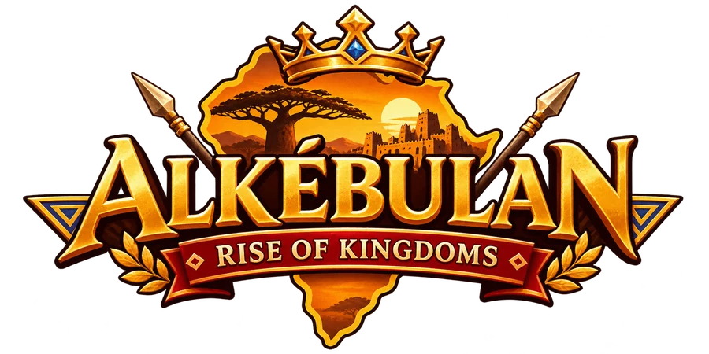
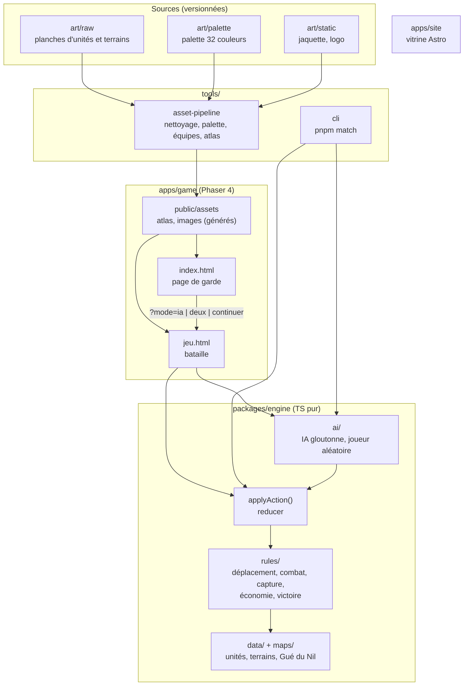
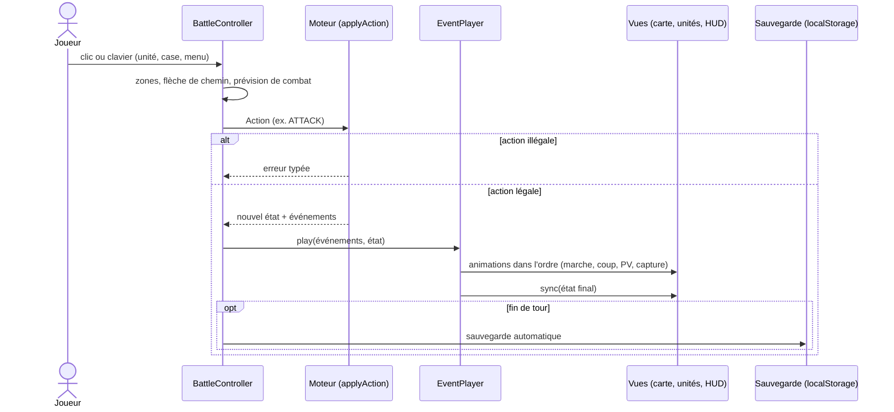
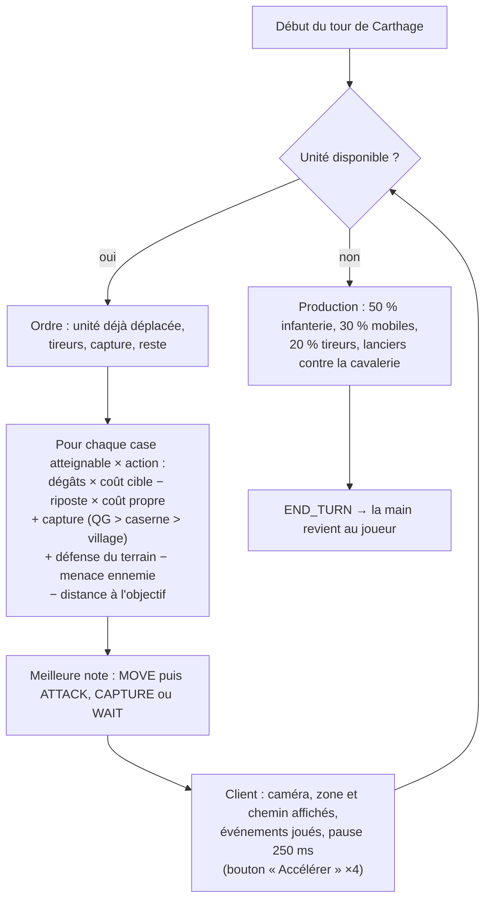
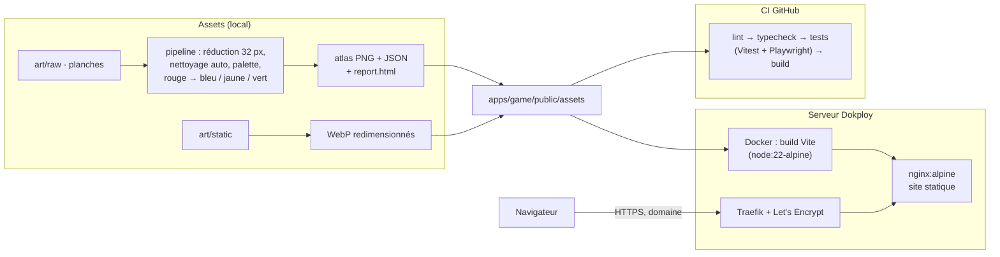

<p align="center">
  
</p>

<p align="center">
  <strong>Tactique au tour par tour dans l'Afrique antique, jouable dans le navigateur.</strong><br />
  Koush contre Carthage sur la carte du Gué du Nil : capturez les villages, levez vos armées, prenez le QG adverse.
</p>

---

## L'esprit du jeu

Alkébulan reprend les codes des jeux de tactique sur console portable des années 2000 : une
grille, des tours alternés, des unités qui se contrent (le lancier arrête la cavalerie, la
catapulte écrase l'infanterie, l'archer frappe sans riposte), des villages à capturer pour
financer son armée et un QG à prendre pour gagner. Les tanks et les avions laissent la place
aux armées de l'Antiquité africaine et méditerranéenne : fantassins aux boucliers de peau,
chars de guerre, catapultes, sur une savane traversée par le Nil.

Trois principes guident tout le projet :

1. **Lisible avant d'être beau.** Pixel art 32 px, zoom entier uniquement, une partie se
   comprend d'un coup d'œil.
2. **Les règles d'abord.** Le moteur de règles est écrit, testé et jouable en ligne de
   commande avant toute image. Le rendu ne fait qu'illustrer ce que le moteur décide.
3. **Rien à la main qui puisse être automatisé.** Sprites nettoyés, quantifiés et assemblés
   par un pipeline ; tests et build à chaque commit ; déploiement par Docker.

Le nom vient d'*Alkebulan*, l'un des noms anciens donnés au continent africain.

## Où on en est

Le **Stage 1** vise une carte jouable de bout en bout, contre l'IA, en 8 étapes.

| # | Étape | État |
| --- | --- | --- |
| 1 | Fondations : monorepo, lint, tests, CI | ✅ |
| 2 | Moteur de règles pur, match en ligne de commande | ✅ |
| 3 | Rendu et interaction : curseur, zones, chemin, menus | ✅ |
| 4 | Pipeline d'assets : sprites nettoyés, couleurs d'équipe, atlas | ✅ |
| 5 | Boucle complète : production, HUD, prévision, sauvegarde, écran de fin | ✅ |
| 6 | IA adverse « gloutonne » | ✅ |
| 7 | Habillage : sons, musique, transitions, tactile | ⬜ |
| 8 | Site vitrine et lancement | ⬜ (page de garde déjà en place) |

Contenu jouable aujourd'hui : 2 factions (Koush, Carthage), 6 unités, 12 terrains et
bâtiments, la carte « Le Gué du Nil » (20×14), une partie contre l'IA ou à deux sur le
même écran, sauvegarde automatique à chaque fin de tour.

Les idées retenues pour la suite (campagne, bouton Quitter, musique, scènes de combat
animées) sont dans [`docs/ajustements.md`](docs/ajustements.md).

## Démarrer

Prérequis : Node 22 et pnpm 10 (`corepack enable`).

```bash
pnpm install
pnpm dev            # http://localhost:5173 : page de garde, puis le jeu
```

| Commande | Rôle |
| --- | --- |
| `pnpm dev` | Client de jeu en développement (Vite) |
| `pnpm test` | Tests du moteur (Vitest, couverture), du pipeline, et parcours Playwright |
| `pnpm lint` / `pnpm typecheck` | ESLint + Prettier / TypeScript strict sur tous les paquets |
| `pnpm build` | Build de production de tous les paquets |
| `pnpm match` | Partie entre deux joueurs aléatoires, en console (moteur seul) |
| `pnpm assets:build` | Planches d'art → atlas Phaser + rapport visuel |
| `pnpm assets:cover` | Images de la page de garde → WebP |

## Architecture

### Vue d'ensemble

Le jeu est un **site statique** : aucune donnée ne quitte le navigateur au Stage 1. Le
monorepo sépare strictement les règles (TypeScript pur), le rendu (Phaser), les outils et
l'art.



**Règle n°1 :** `packages/engine` n'importe jamais Phaser, ni rien de `apps/` ou `tools/`.
ESLint le vérifie. C'est ce qui rend les règles testables à 97 %, permet à l'IA de simuler
des coups, et permettra plus tard à un serveur d'exécuter exactement le même moteur pour
valider les tours en multijoueur.

### Le moteur de règles

Une seule porte d'entrée, déterministe et immuable :

```ts
applyAction(state, action) → { ok: true, state, events } | { ok: false, error }
```

- **Actions** : `MOVE`, `ATTACK`, `CAPTURE`, `WAIT`, `BUILD`, `END_TURN`.
- **Événements** renvoyés dans l'ordre : `unitMoved`, `attackResolved`, `counterResolved`,
  `unitDestroyed`, `captureProgress`, `buildingCaptured`, `unitBuilt`, `turnStarted`,
  `fundsGained`, `gameOver`…
- **Hasard reproductible** : la chance des dégâts vient d'un PRNG mulberry32 dont la graine
  est dans l'état. Même état + mêmes actions = même partie, au pixel près.
- **Erreurs typées** : une action illégale renvoie un code (`UNREACHABLE`,
  `TARGET_OUT_OF_RANGE`, `INSUFFICIENT_FUNDS`…), jamais une exception silencieuse.

| Module | Contenu |
| --- | --- |
| `data/` | Unités, terrains, table des dégâts de base, factions (valeurs de [`docs/game-design.md`](docs/game-design.md)) |
| `rules/movement.ts` | Dijkstra borné par les points de mouvement (file à seaux), alliés traversables, ennemis bloquants |
| `rules/combat.ts` | Formule de dégâts, riposte, tir indirect, `forecast()` sans consommer le hasard |
| `rules/capture.ts`, `economy.ts`, `turn.ts`, `victory.ts` | Capture en 20 points, revenus et production, fin de tour, victoire (QG ou déroute) |
| `ai/greedy-ai.ts` | IA gloutonne : `chooseGreedyAction()`, `planTurn()` |
| `maps/` | Cartes décrites en texte, « Le Gué du Nil » symétrique par rotation |

### La boucle d'une action

Le client ne modifie **jamais** l'état : il traduit une intention en `Action`, laisse le
moteur trancher, puis joue les événements.



Annuler un déplacement revient simplement à reprendre l'état d'avant le `MOVE` : le moteur
n'a rien tiré au hasard.

### Le tour de l'IA

L'IA est dans le moteur, le client se contente de la faire jouer à un rythme lisible.



Elle ne tire rien au hasard et réévalue l'état après chaque action. Mesuré en simulation :
elle bat un joueur passif en 9 jours et le joueur aléatoire 10 fois sur 10.

### Le client de jeu

| Élément | Rôle |
| --- | --- |
| `index.html` + `src/garde/` | Page de garde HTML/CSS, sans Phaser : Nouvelle partie, Continuer, À deux |
| `jeu.html` + `src/main.ts` | Jeu Phaser 4, résolution logique 640×384 (20×12 cases), zoom entier ×1/×2/×3 |
| `src/launch.ts` | Lit `?mode=` et prépare la bataille ; recharger reprend la sauvegarde |
| `controller/BattleController.ts` | Seul endroit qui crée des `Action` et remplace l'état ; modes `idle`, `selected`, `menu`, `targeting`, `ai`, `over` |
| `animation/EventPlayer.ts` | File d'événements jouée dans l'ordre, puis recalage sur l'état final |
| `view/` | Carte, unités animées, curseur, zones, flèche, menus, HUD, prévision, bandeau, écran de fin |
| `persistence/save.ts` | Sauvegarde JSON de l'état et des camps joués par l'IA |

### Assets et déploiement



- Les **sources d'art** et les **assets générés** ne se mélangent jamais :
  `apps/game/public/assets/` se régénère, il ne s'édite pas.
- L'**image Docker** ne contient que le jeu construit et Nginx. Les fichiers à empreinte
  de Vite sont mis en cache un an ; pages, atlas et images sont revalidés à chaque visite,
  pour qu'un déploiement se voie tout de suite.
- **Dokploy** construit l'image depuis `main` (`docker-compose.yml`) et rattache le domaine
  en HTTPS.

## Qualité

| Contrôle | Contenu |
| --- | --- |
| Moteur | 114 tests Vitest, un fichier par règle, couverture ≈ 97 % (seuil imposé : 80 %) |
| IA | 200 débuts de partie sans action illégale, victoires contre joueurs passif et aléatoire |
| Pipeline d'assets | 14 tests (réduction, nettoyage, palette, autotiling) |
| Parcours de bout en bout | 4 tests Playwright : page de garde, partie à deux, tour de l'IA, reprise de sauvegarde |
| Style | TypeScript strict (`noUncheckedIndexedAccess`, `exactOptionalPropertyTypes`), ESLint, Prettier |

## Arborescence

```text
.
├─ packages/engine/        # @antiqua/engine — règles, IA, cartes (TypeScript pur)
│  ├─ src/{data,model,rules,ai,maps}/
│  └─ test/                # un fichier de test par règle
├─ apps/
│  ├─ game/                # @antiqua/game — page de garde + client Phaser
│  │  ├─ index.html        # page de garde
│  │  ├─ jeu.html          # le jeu
│  │  ├─ src/{garde,scenes,controller,animation,view,ui,persistence}/
│  │  ├─ public/assets/    # généré : atlas/, garde/
│  │  └─ e2e/              # parcours Playwright
│  └─ site/                # vitrine Astro (étape 8)
├─ tools/
│  ├─ asset-pipeline/      # art → atlas, images de garde
│  └─ cli/                 # pnpm match
├─ art/                    # sources : raw/, static/, palette/
├─ docs/                   # game design, bible artistique, ajustements, bible de production
├─ Dockerfile · nginx.conf · docker-compose.yml
└─ CLAUDE.md               # règles du projet pour Claude Code
```

## Documentation

| Document | Contenu |
| --- | --- |
| [`docs/game-design.md`](docs/game-design.md) | Règles, unités, terrains, formule de dégâts : la source de vérité |
| [`docs/art-bible.md`](docs/art-bible.md) | Grille, palette, tailles de sprites, couleurs d'équipe |
| [`docs/ajustements.md`](docs/ajustements.md) | Idées retenues pour plus tard |
| [`docs/bible-de-production.md`](docs/bible-de-production.md) | Bible d'origine : vision, prompts d'images et de développement par étape |
| [`CLAUDE.md`](CLAUDE.md) | Architecture et conventions pour travailler avec Claude Code |

## Feuille de route

- **Stage 1** : la carte du Gué du Nil contre l'IA, habillage sonore, site vitrine.
- **Stage 2** : commandants et pouvoirs, brouillard de guerre, éléphants et navires,
  campagne de 5 cartes, scènes de combat animées.
- **Stage 3** : multijoueur asynchrone, le serveur exécutant le même moteur.
- **Stage 4** : éditeur de cartes communautaire.

## Nom, marques et crédits

- Le jeu s'inspire des **mécaniques** du genre tactique sur grille, jamais de son nom, de
  ses personnages ni de ses visuels.
- « Rise of Kingdoms » est déjà le titre d'un jeu mobile commercial : le sous-titre est à
  vérifier avant toute publication. Le nom de travail d'origine, *ANTIQUA*, ne subsiste que
  dans les identifiants techniques (`@antiqua/*`).
- Police du jeu : **m5x7** de Daniel Linssen.
